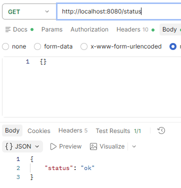
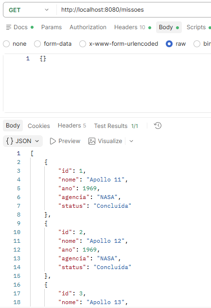
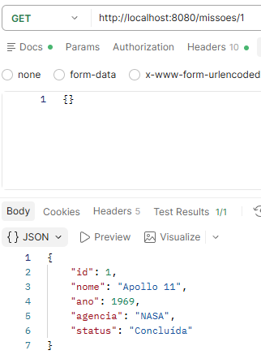
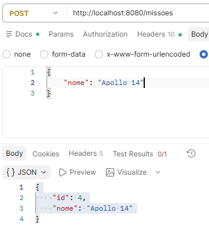
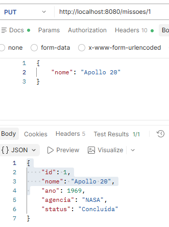
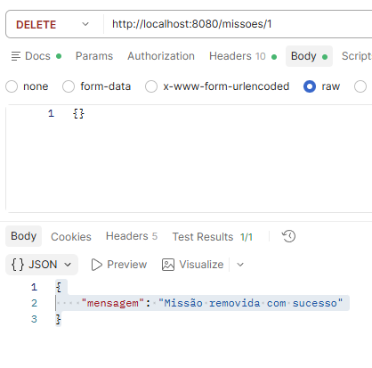

# API de Missões Espaciais

API REST para consulta e gerenciamento de missões espaciais, desenvolvida com PHP e Slim Framework.

## Identificação

- **Nome do aluno:** Davi Santana
- **Curso:** Informática
- **Unidade Curricular:** Desenvolver Serviços Web

## Descrição do Projeto

A API disponibiliza operações para consultar, filtrar, cadastrar, atualizar e remover missões espaciais. Os dados de exemplo ficam armazenados em memória durante a execução da aplicação; por isso, as alterações são perdidas quando o servidor é reiniciado.

## Instala o test

- composer require --dev phpunit/phpunit

## Tecnologias Utilizadas

- PHP 8
- Slim Framework 4
- Slim PSR-7
- Composer
- JSON

## Como Clonar o Projeto

Substitua `URL_DO_REPOSITORIO` pela URL do repositorio:

```bash
git clone URL_DO_REPOSITORIO
cd nasa
```

## Como Instalar as Dependências

Na pasta do projeto, execute:

```bash
composer install
```

## Como Executar o Projeto

Na raiz do projeto, inicie o servidor PHP:

```bash
php -S localhost:8080 -t public public/index.php
```

A API ficará disponível em `http://localhost:8080`.

## Documentação dos Endpoints

Os exemplos abaixo consideram a URL base `http://localhost:8080` e os dados iniciais definidos em `public/index.php`.

### Verificar status

- **Metodo:** `GET`
- **URL:** `/status`
- **Objetivo:** verificar se a API esta funcionando.
- **Requisicao:** `GET http://localhost:8080/status`
- **Resposta:** `200 OK`
- **Print:** !
```json
{"status":"ok"}
```

### Listar missões

- **Metodo:** `GET`
- **URL:** `/missoes`
- **Objetivo:** listar todas as missões. O parâmetro opcional `nome` filtra pelo nome, sem diferenciar maiúsculas de minúsculas.
- **Requisicao:** `GET http://localhost:8080/missoes?nome=apollo`
- **Resposta:** `200 OK`
- **Print:** 
```json
[
  {"id":1,"nome":"Apollo 11","ano":1969,"agencia":"NASA","status":"Concluída"},
  {"id":2,"nome":"Apollo 12","ano":1969,"agencia":"NASA","status":"Concluída"},
  {"id":3,"nome":"Apollo 13","ano":1970,"agencia":"NASA","status":"Andamento"}
]
```

### Consultar missão por ID

- **Metodo:** `GET`
- **URL:** `/missoes/{id}`
- **Objetivo:** consultar uma missão pelo seu identificador.
- **Requisicao:** `GET http://localhost:8080/missoes/1`
- **Resposta de sucesso:** `200 OK`
- **Print:** 

```json
{"id":1,"nome":"Apollo 11","ano":1969,"agencia":"NASA","status":"Concluída"}
```

Se o ID nao existir, a API retorna `404 Not Found`:

```json
{"erro":"Missão não encontrada"}
```

### Cadastrar missão

- **Metodo:** `POST`
- **URL:** `/missoes`
- **Objetivo:** cadastrar uma missão informando seu nome.
- **Cabeçalho:** `Content-Type: application/json`
- **Requisição:** `POST http://localhost:8080/missoes`
- **Print:** 

```json
{"nome":"Artemis I"}
```

- **Resposta:** `201 Created`

```json
{"id":4,"nome":"Artemis I"}
```

### Atualizar missão

- **Metodo:** `PUT`
- **URL:** `/missoes/{id}`
- **Objetivo:** atualizar o nome de uma missao.
- **Cabeçalho:** `Content-Type: application/json`
- **Requisição:** `PUT http://localhost:8080/missoes/1`
- **Print:** 

```json
{"nome":"Apollo 11 - atualizada"}
```

- **Resposta:** `200 OK`

```json
{"id":1,"nome":"Apollo 11 - atualizada","ano":1969,"agencia":"NASA","status":"Concluída"}
```

Se o ID não existir, a API retorna `404 Not Found`. **Pendência:** atualmente, a resposta mostra o nome atualizado, mas a alteração não é gravada na lista de missões.

### Remover missão

- **Metodo:** `DELETE`
- **URL:** `/missoes/{id}`
- **Objetivo:** remover uma missão pelo seu identificador.
- **Requisicao:** `DELETE http://localhost:8080/missoes/1`
- **Resposta de sucesso:** `200 OK`
- **Print:** 

```json
{"mensagem":"Missão removida com sucesso"}
```

Se o ID nao existir, a API retorna `404 Not Found`:

```json
{"erro":"Missão não encontrada"}
```

Todas as respostas dos endpoints são enviadas em JSON com o cabeçalho `Content-Type: application/json`.

```markdown

```

Inclua capturas que mostrem as requisições e os respectivos status e respostas, cobrindo `GET`, `GET por ID`, `POST`, `PUT` e `DELETE`.